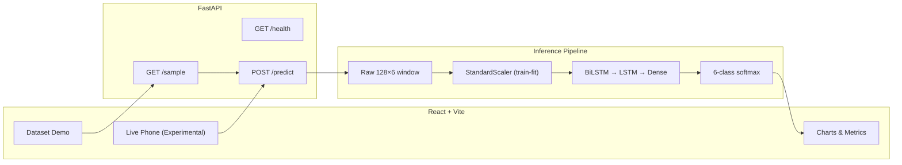

# Kinetix

**Human Activity Recognition** — a full-stack ML system that classifies smartphone motion into six daily activities using a BiLSTM trained on the [UCI HAR Dataset](https://archive.ics.uci.edu/ml/datasets/human+activity+recognition+using+smartphones).

The React dashboard runs **real inference** against a saved TensorFlow model via FastAPI. Dataset Demo uses official UCI test windows; Live Phone mode collects browser motion sensors (experimental, not quantitatively evaluated).

---

## Features

- **BiLSTM classifier** — 128×6 inertial windows → 6-class softmax
- **Dataset Demo** — load a real UCI HAR test sample, compare prediction vs ground truth
- **Experimental Live Phone Mode** — capture 128 motion samples from `DeviceMotionEvent` and predict
- **Research dashboard** — probabilities, sensor charts, metrics, confusion matrix, training curves
- **Reproducible pipeline** — documented preprocessing, scaler fit on train only, no test leakage

---

## Architecture



---

## Tech Stack

| Layer | Technology |
|-------|------------|
| Frontend | React 19, Vite, Axios, Recharts |
| Backend | FastAPI, Uvicorn, Pydantic |
| ML | TensorFlow/Keras, scikit-learn |
| Data | UCI HAR inertial signals (body acc + gyro) |

---

## Dataset

**UCI Human Activity Recognition Using Smartphones** — Samsung Galaxy S II, 50 Hz, 128-sample windows (2.56 s), 6 activities:

| Index | Activity |
|------:|----------|
| 0 | WALKING |
| 1 | WALKING_UPSTAIRS |
| 2 | WALKING_DOWNSTAIRS |
| 3 | SITTING |
| 4 | STANDING |
| 5 | LAYING |

**Input features (per timestep):** `body_acc_x/y/z` (g), `body_gyro_x/y/z` (rad/s)

### Obtaining the dataset

The UCI HAR dataset is **not committed** to this repository (~60 MB). Download and extract:

1. Get the dataset from [UCI ML Repository](https://archive.ics.uci.edu/ml/datasets/human+activity+recognition+using+smartphones)
2. Extract to `data/UCI HAR Dataset/` (must contain `train/` and `test/` with `Inertial Signals/`)

License: see `data/UCI HAR Dataset/README.txt` after download.

---

## Preprocessing

1. Load raw UCI inertial files (128 timesteps × 6 features)
2. Fit `StandardScaler` on **training** timesteps only
3. At inference: scale each window **once** → shape `(1, 128, 6)`
4. Labels: UCI 1–6 → model indices 0–5

See [`docs/ML_PIPELINE_AUDIT.md`](docs/ML_PIPELINE_AUDIT.md) for the full audit.

---

## BiLSTM Architecture

```
Input (128, 6)
  → Bidirectional LSTM(128, return_sequences=True)
  → BatchNormalization → Dropout(0.3)
  → LSTM(64)
  → Dropout(0.3)
  → Dense(64, relu) → Dense(6, softmax)
```

| Property | Value |
|----------|------:|
| Parameters | ~226,000 |
| Optimizer | Adam (lr=0.001) |
| Class weights | Balanced |
| Saved model | `models/kinetix_lstm.keras` |
| Scaler | `models/scaler.pkl` |

---

## Evaluation (measured on UCI test set)

| Metric | Value |
|--------|------:|
| **Test accuracy** | **86.90%** |
| **Macro F1** | **87.15%** |
| WALKING F1 | 95.18% |
| WALKING_UPSTAIRS F1 | 95.74% |
| WALKING_DOWNSTAIRS F1 | 94.56% |
| SITTING F1 | 70.91% |
| STANDING F1 | 80.83% |
| LAYING F1 | 85.66% |

Confusion matrix: `models/confusion_matrix.png` (also served at `/assets/confusion_matrix.png` in the frontend).

Re-evaluate:

```bash
cd backend
python evaluate_model.py
```

---

## Frontend

Dark research dashboard with:

- Input mode selector: **Dataset Demo** / **Live Phone**
- Activity prediction + confidence + probability chart
- Sensor window visualization (accelerometer / gyroscope toggle)
- Model info, evaluation metrics, training history curves

---

## FastAPI API

| Method | Path | Description |
|--------|------|-------------|
| GET | `/health` | `{"status": "ok"}` |
| GET | `/sample` | Raw UCI test window + ground truth |
| POST | `/predict` | Inference on `(128, 6)` sensor window |

### POST `/predict`

```json
{
  "sensor_data": [[acc_x, acc_y, acc_z, gyro_x, gyro_y, gyro_z], ...],
  "input_source": "dataset"
}
```

`input_source` is optional (`"dataset"` or `"live"`). Preprocessing is identical.

Errors return JSON: `{"detail": "..."}` with HTTP 400 (validation) or 503 (missing dataset).

---

## Dataset Demo

1. Select **Dataset Demo**
2. Click **Run Prediction**
3. Loads `GET /sample` (UCI test index 0) → `POST /predict`
4. Shows detected activity, confidence, ground truth comparison, charts

---

## Experimental Live Phone Mode

Collects browser `DeviceMotionEvent` data, builds a 128×6 window with approximate UCI-compatible preprocessing (gravity removal, unit conversion), and sends it to `POST /predict`.

**Important:** Live mode has **not** been quantitatively evaluated against labeled phone data. Browser preprocessing is an approximation. See [`docs/LIVE_SENSOR_PIPELINE.md`](docs/LIVE_SENSOR_PIPELINE.md).

For mobile testing:

```bash
# Backend (all interfaces)
cd backend
python -m uvicorn app.main:app --host 0.0.0.0 --port 8000

# Frontend — set API URL to your machine's LAN IP
# frontend/.env.local:
# VITE_API_URL=http://192.168.x.x:8000
cd frontend
npm run dev
```

---

## Local Setup

### Prerequisites

- Python 3.11+
- Node.js 18+
- UCI HAR dataset in `data/UCI HAR Dataset/`

### Backend

```bash
cd backend
python -m venv .venv
# Windows: .venv\Scripts\activate
# macOS/Linux: source .venv/bin/activate
pip install -r requirements.txt
python -m uvicorn app.main:app --reload --host 127.0.0.1 --port 8000
```

### Frontend

```bash
cd frontend
npm install
npm run dev
```

Open http://localhost:5173

### Tests

```bash
# Unit tests (no server)
cd backend
python -m unittest tests.test_pipeline -v

# API integration (server must be running)
python test_api.py

# Production build
cd frontend
npm run build
```

---

## Environment Variables

### Frontend (`frontend/.env.local`)

Copy from `frontend/.env.example`:

| Variable | Default | Description |
|----------|---------|-------------|
| `VITE_API_URL` | `http://localhost:8000` | FastAPI base URL |

### Backend (`backend/.env`)

Copy from `backend/.env.example`:

| Variable | Default | Description |
|----------|---------|-------------|
| `KINETIX_MODEL_PATH` | `models/kinetix_lstm.keras` | Path to saved Keras model |
| `KINETIX_SCALER_PATH` | `models/scaler.pkl` | Path to StandardScaler |
| `KINETIX_DATA_DIR` | `data/UCI HAR Dataset` | UCI dataset root |
| `KINETIX_CORS_ORIGINS` | `http://localhost:5173,...` | Comma-separated allowed origins |
| `KINETIX_CORS_ORIGIN_REGEX` | LAN regex | Set to `none` to disable regex matching |
| `KINETIX_API_URL` | `http://localhost:8000` | Used by `test_api.py` only |

**Do not commit `.env` files.**

---

## Project Structure

```text
Kinetix/
├── backend/
│   ├── app/
│   │   ├── main.py           # FastAPI routes
│   │   ├── config.py         # Paths + CORS from env
│   │   ├── model.py          # BiLSTM loader
│   │   ├── preprocessing.py  # StandardScaler
│   │   └── data_loader.py    # UCI sample loader
│   ├── tests/
│   ├── evaluate_model.py
│   ├── test_api.py
│   └── requirements.txt
├── frontend/
│   ├── src/components/       # Dashboard panels
│   ├── src/hooks/              # Live sensor capture
│   └── public/assets/          # metrics.json, charts
├── models/                     # kinetix_lstm.keras, scaler.pkl, metrics
├── training/train.py           # Reproducible training script
├── data/UCI HAR Dataset/       # Not committed — download separately
└── docs/
    ├── ML_PIPELINE_AUDIT.md
    ├── LIVE_SENSOR_PIPELINE.md
    └── DEMO_SAMPLE_VALIDATION.md
```

---

## Screenshots

<!-- Add after running locally -->
| Dashboard | Prediction | Evaluation |
|-----------|------------|------------|
| _screenshot/dashboard.png_ | _screenshot/prediction.png_ | _screenshot/evaluation.png_ |

---

## Known Limitations

1. **Static activity confusion** — SITTING/STANDING/LAYING still overlap on the test set despite 86.90% accuracy.
2. **Live mode is experimental** — browser sensor preprocessing ≠ UCI pipeline; no measured live accuracy.
3. **Dataset required** — `/sample` returns 503 if UCI data is not downloaded.
4. **Desktop has no motion sensors** — Live Phone mode requires a mobile browser.
5. **Legacy `.npy` artifacts** in `models/` are gitignored; inference uses `.keras` + `.pkl` only.

---

## Future Improvements

- Quantitative evaluation of live phone preprocessing against labeled data
- Improved gravity removal / axis alignment for live sensors
- Subject-aware or personalized calibration
- Model export (TFLite) for on-device inference
- Deployment with HTTPS for iOS motion permissions

---

## License

UCI HAR Dataset — see dataset README after download. Application code: portfolio/educational use.
