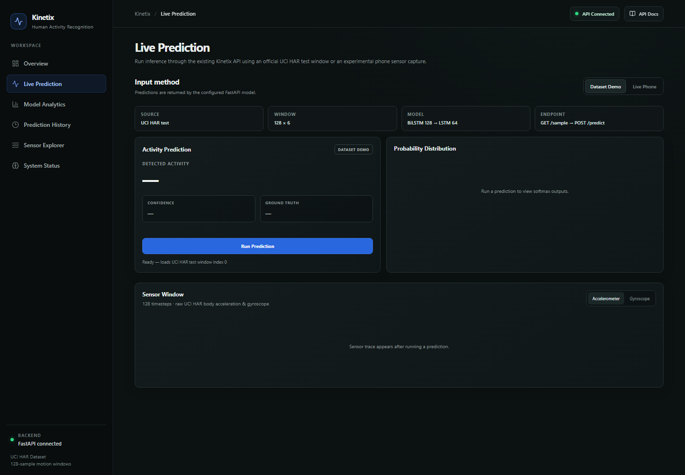
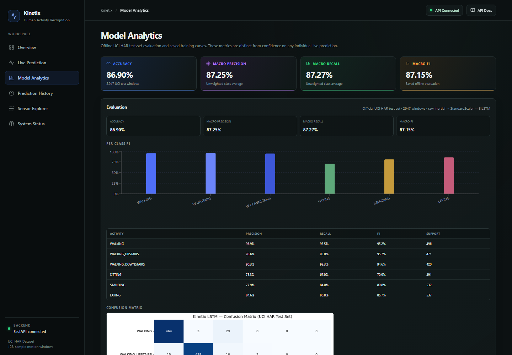
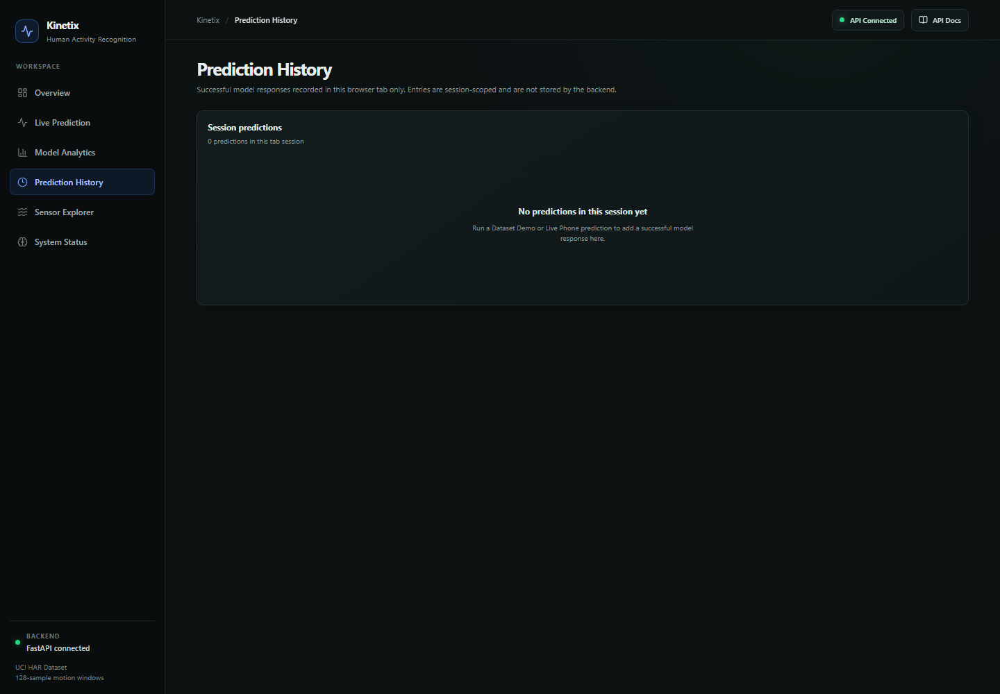
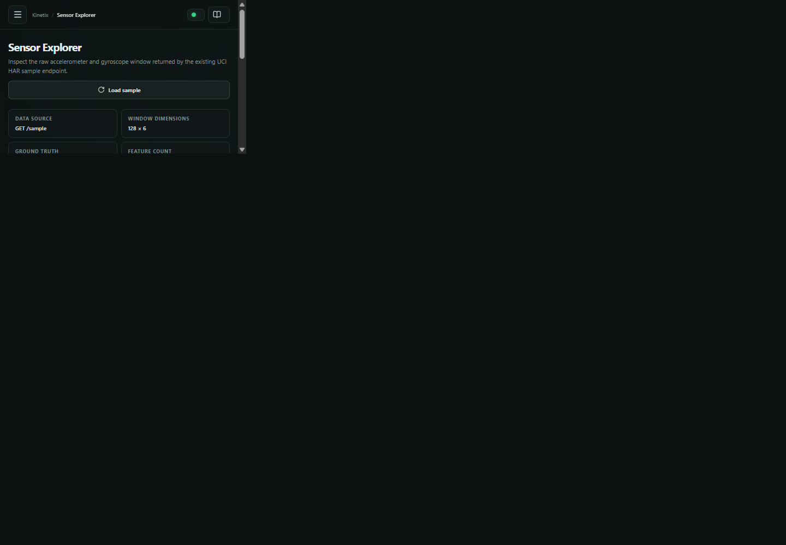
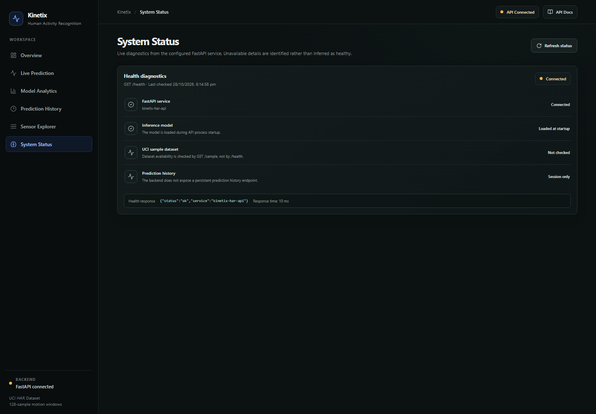
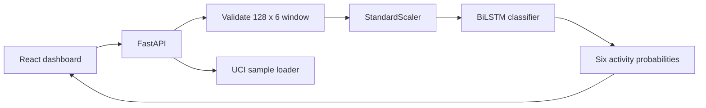

# Kinetix

<p align="center">
  <strong>Human Activity Recognition from Smartphone Motion Sensors</strong><br/>
  A full-stack machine-learning demo combining a BiLSTM model, FastAPI inference, and a React dashboard.
</p>

<p align="center">
  <a href="https://github.com/HarshithhKumar/Kinetix/actions/workflows/ci.yml"></a>
  
  
  
  
</p>

Kinetix classifies six everyday activities from accelerometer and gyroscope windows in the [UCI Human Activity Recognition (HAR) dataset](https://archive.ics.uci.edu/ml/datasets/human+activity+recognition+using+smartphones). The dashboard runs inference against a saved TensorFlow model through FastAPI.

> **Evaluation note:** Reported metrics are measured on the UCI test set. Browser-based Live Phone mode is experimental and has not been quantitatively evaluated.

## Evaluation status

The reported accuracy is currently **under re-validation**. The committed metrics artifact reports 86.90% accuracy and 87.15% macro F1, while the repository's audit notes report a different result when evaluating the saved model with the documented inference path. The resume's approximately 97% figure is not reproduced by the current repository evidence.

Until the model artifact, preprocessing path, and evaluation output are regenerated and verified together, this README does not present a single accuracy figure as a final result. The evaluation script is available at [backend/evaluate_model.py](backend/evaluate_model.py).

## Features

- **Six-page dashboard:** Overview, Live Prediction, Model Analytics, Prediction History, Sensor Explorer, and System Status.
- **Dataset Demo:** run inference on a real UCI test window and compare the prediction with its ground-truth label.
- **Live Phone (experimental):** capture browser motion data and submit a window for inference.
- **Model insights:** class probabilities, sensor charts, confusion matrix, evaluation metrics, and training curves.
- **Offline evaluation cards:** summary metrics are sourced from the saved UCI test-set artifact, not live inference.
- **Session history:** view successful predictions in the current browser tab; entries are not stored by the backend.
- **System diagnostics:** check the real FastAPI health response and clearly identify details the API does not expose.
- **API documentation:** open the configured backend's `/docs` endpoint from the dashboard.
- **Reproducible preprocessing:** fit the scaler on training data only and apply it consistently at inference.
- **REST API:** expose health, sample, and prediction endpoints through FastAPI.

## Frontend routes

| Route | Page | Data |
|---|---|---|
| `/overview` | Summary metrics and Dataset Demo quick classify | Saved evaluation artifact and live API requests |
| `/predict` | Dataset Demo and experimental Live Phone workflows | `GET /sample`, `POST /predict` |
| `/analytics` | Offline metrics, per-class results, confusion matrix, training curves | `frontend/public/assets/metrics.json` and `training_history.json` |
| `/history` | Searchable current-tab prediction log | Browser `sessionStorage` only; no backend history endpoint exists |
| `/sensors` | Accelerometer and gyroscope plots for an actual sample window | `GET /sample`; requires the UCI HAR dataset on the backend |
| `/status` | FastAPI health, model-startup inference, and endpoint availability notes | `GET /health` |

`GET /health` reports service health, not a separate model-readiness field. The model is loaded at API startup; a healthy response therefore indicates that the API process started successfully. Dataset availability is checked through `/sample`, not `/health`.

The app supports direct path navigation and maps the older root hash links (such as `/#overview` and `/#evaluation`) to their corresponding pages. Production static hosts must rewrite unknown application paths to `index.html` for direct-route refreshes.

## Screenshots

<table>
  <tr>
    <td align="center">
      
      <br />
      <strong>Live Prediction</strong>
    </td>
    <td align="center">
      
      <br />
      <strong>Model Analytics</strong>
    </td>
  </tr>
  <tr>
    <td align="center">
      
      <br />
      <strong>Prediction History</strong>
    </td>
    <td align="center">
      
      <br />
      <strong>Sensor Explorer</strong>
    </td>
  </tr>
  <tr>
    <td align="center" colspan="2">
      
      <br />
      <strong>System Status</strong>
    </td>
  </tr>
</table>

## Architecture



## Model and input

Each example contains **128 time steps × 6 features**:

- Body acceleration: `body_acc_x`, `body_acc_y`, `body_acc_z`
- Body gyroscope: `body_gyro_x`, `body_gyro_y`, `body_gyro_z`

The model uses a Bidirectional LSTM followed by an LSTM and dense classification layers. The saved artifacts are `models/kinetix_lstm.keras` and `models/scaler.pkl`.

| Activity index | Label |
|---:|---|
| 0 | WALKING |
| 1 | WALKING_UPSTAIRS |
| 2 | WALKING_DOWNSTAIRS |
| 3 | SITTING |
| 4 | STANDING |
| 5 | LAYING |

## Dataset setup

The UCI dataset is not committed to this repository. Download it from the [UCI repository](https://archive.ics.uci.edu/ml/datasets/human+activity+recognition+using+smartphones) and extract it so the directory `data/UCI HAR Dataset/` contains the `train/` and `test/` folders, including their `Inertial Signals/` subdirectories.

See [docs/ML_PIPELINE_AUDIT.md](docs/ML_PIPELINE_AUDIT.md) for preprocessing details.

## Quick start

### Backend

Requirements: Python 3.11+ and the UCI dataset in the expected location.

```bash
cd backend
python -m venv .venv
# Windows: .venv\Scripts\activate
# macOS/Linux: source .venv/bin/activate
pip install -r requirements.txt
python -m uvicorn app.main:app --reload --host 127.0.0.1 --port 8000
```

### Frontend

In another terminal:

```bash
cd frontend
npm install
npm run dev
```

Open [http://localhost:5173/overview](http://localhost:5173/overview). Configure `VITE_API_URL` in `frontend/.env.local` if the API is hosted somewhere else; use `frontend/.env.example` as the reference. When unset, the existing development default is `http://localhost:8000`.

### Tests and evaluation

```bash
# Backend pipeline unit tests
cd backend
python -m unittest tests.test_pipeline -v

# Evaluate the saved model
python evaluate_model.py

# Frontend production build
cd frontend
npm run build

# Frontend lint and route tests
npm run lint
npm test
```

For API integration testing, start the backend first, then run `python test_api.py` from `backend/`.

## API

| Method | Endpoint | Purpose |
|---|---|---|
| `GET` | `/health` | Service health |
| `GET` | `/sample` | UCI test window and ground truth |
| `POST` | `/predict` | Classify a 128 × 6 sensor window |

Example request:

```json
{
  "sensor_data": [[0.1, 0.2, 0.3, 0.01, 0.02, 0.03]],
  "input_source": "dataset"
}
```

The example shows the request shape only; the API expects a complete 128-row window. `input_source` is optional and can be `dataset` or `live`.

## Project structure

```text
backend/       FastAPI routes, preprocessing, model loading, tests
frontend/      React dashboard and sensor capture
training/      Model training script
models/        Saved model, scaler, and evaluation artifacts
docs/          ML pipeline audit and live-sensor notes
data/          Downloaded UCI dataset (not committed)
```

## Limitations and next steps

- SITTING, STANDING, and LAYING are harder to distinguish than dynamic activities.
- Live Phone preprocessing approximates the UCI sensor pipeline and has no measured live accuracy.
- The UCI dataset must be downloaded locally; `/sample` cannot serve a sample without it.
- Live Phone requires a mobile browser with motion-sensor support.
- Future work includes evaluating labeled phone recordings, improving axis alignment and gravity removal, and exploring on-device inference.

## Technical implementation notes

### Inference flow

The backend separates HTTP handling, request schemas, dataset loading, preprocessing, and model inference into distinct modules:

- `backend/app/main.py` defines the FastAPI routes and CORS middleware.
- `backend/app/schemas.py` defines Pydantic request and response contracts.
- `backend/app/data_loader.py` assembles the six UCI inertial signals and maps test labels to activity names.
- `backend/app/preprocessing.py` validates the input shape, applies the persisted `StandardScaler`, and prepares the tensor for inference.
- `backend/app/model.py` loads the Keras model and maps its six output scores to activity labels.

A valid request contains 128 time steps, each with six ordered values: body acceleration X/Y/Z followed by gyroscope X/Y/Z. The window represents approximately 2.56 seconds at the UCI dataset's 50 Hz sampling rate. Feature order, units, filtering, gravity separation, and scaling are part of the model's input contract; arbitrary phone sensor readings should not be assumed compatible without equivalent preprocessing.

### API behavior

| Endpoint | Contract | Operational note |
|---|---|---|
| `GET /health` | Service status metadata | Confirms the API is responding; it does not measure model quality or dataset availability |
| `GET /sample` | Sensor window, ground truth, shape, and feature names | Requires the UCI HAR dataset at the configured path |
| `POST /predict` | Activity label, confidence, and class probabilities | Requires a complete 128 × 6 window |

FastAPI generates the OpenAPI schema from the route and Pydantic definitions. Invalid request bodies are handled by schema validation, and invalid window dimensions are rejected by preprocessing. The sample endpoint reports dataset unavailability rather than silently substituting synthetic sensor data.

### Frontend and evaluation

The React/Vite frontend uses a shared dashboard shell across six routes. Recharts visualizations use saved evaluation artifacts or actual sample data where available. Model Analytics describes offline evaluation; a single live inference is not a benchmark. Prediction History is currently scoped to browser session storage and is not persistent server-side history.

The model's reported metrics remain under re-validation because the saved metrics and audit findings need to be reconciled against the same model artifact, scaler, test inputs, and labels. Before quoting a headline score in a résumé or portfolio, regenerate the evaluation artifacts with the documented inference pipeline and verify that the results are reproducible.

### Configuration and deployment

- Use `frontend/.env.example` as the reference for configuring `VITE_API_URL`; keep local environment files and credentials out of Git.
- Configure backend CORS origins for the actual frontend origin. Development settings should not automatically be treated as production security settings.
- The model and scaler must exist at the paths resolved by backend configuration; the UCI dataset is required for `GET /sample`.
- Static hosting should rewrite direct application routes to the frontend entry point so routes such as `/predict` and `/analytics` also work after a refresh.

## License and data

Application code is intended for portfolio and educational use. Review the UCI dataset README and terms after downloading the dataset.
